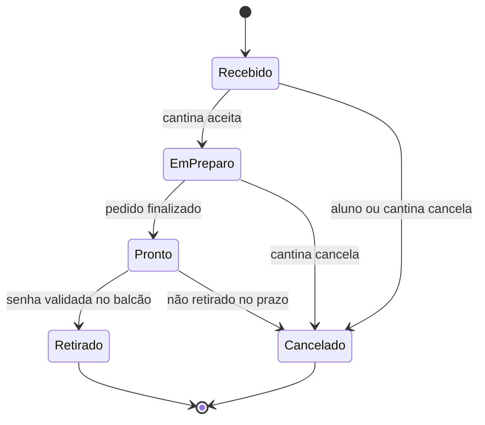

# [CF-014] Acompanhar status do pedido e senha de retirada

> **Exemplo de referência** — mostra o nível de qualidade esperado para cada issue publicada.
> Não é um item obrigatório do backlog; use como gabarito.

| Campo | Valor |
|---|---|
| **Épico** | CF-E06 — Acompanhamento e retirada |
| **Sprint** | Sprint 3 |
| **Tipo** | `tipo:feature` |
| **Área** | `area:pedido` |
| **Prioridade** | `prio:p1` (P1 - Alta) |
| **Tamanho** | `tam:g` (5 pontos) |
| **Depende de** | CF-010 (criar pedido), CF-012 (pagamento aprovado) |
| **Bloqueia** | CF-018 (notificação de pedido pronto) |

---

## Contexto

Depois de confirmar o pedido, o aluno fica sem referência de quando retirar. Hoje isso gera fila no balcão e perguntas repetidas ao atendente. O app precisa mostrar o estado atual do pedido em tempo real e a senha de retirada, funcionando também com conexão instável.

## História

**Como** aluno que acabou de fazer um pedido
**quero** acompanhar o status e ver minha senha de retirada
**para** saber o momento certo de ir ao balcão sem precisar perguntar.

## Regras de negócio

- **RN01** — Os estados válidos são: `Recebido`, `Em preparo`, `Pronto para retirada`, `Retirado` e `Cancelado`.
- **RN02** — A senha de retirada é gerada no momento da confirmação do pedido e não muda depois.
- **RN03** — A senha só é exibida para o dono do pedido e para perfis da cantina.
- **RN04** — O status é atualizado em até 5 segundos após a mudança no backend.
- **RN05** — Sem conexão, o app mostra o último status conhecido com aviso explícito e horário da última atualização.
- **RN06** — Pedido `Retirado` ou `Cancelado` não pode voltar a estados anteriores.
- **RN07** — Ao cancelar, o aluno perde acesso à senha e vê o motivo, quando informado.

## Critérios de aceite

- [ ] **CA01** — A tela do pedido exibe status, senha, itens, total e horário previsto de retirada.
- [ ] **CA02** — Uma mudança de status no backend aparece na tela em até 5 segundos, sem ação do usuário.
- [ ] **CA03** — Ao abrir a tela, o app carrega o status atual mesmo que o usuário tenha ficado offline.
- [ ] **CA04** — Sem conexão, exibe o último status conhecido + aviso "Sem conexão — atualizando quando possível" + horário da última atualização.
- [ ] **CA05** — Usuário sem permissão recebe `403` e vê a mensagem "Pedido não encontrado" (sem vazar existência).
- [ ] **CA06** — Status `Pronto para retirada` destaca a senha e o texto "Retire no balcão".
- [ ] **CA07** — Pedido cancelado mostra o motivo e oculta a senha.
- [ ] **CA08** — Leitor de tela anuncia a mudança de status com `Semantics(liveRegion: true)`.
- [ ] **CA09** — A tela funciona nos temas claro e escuro com contraste mínimo de 4,5:1.
- [ ] **CA10** — Testes de widget cobrem carregamento, sucesso, erro, offline e cancelado.

## Cenários BDD

```gherkin
# language: pt
Funcionalidade: Acompanhar status do pedido
  Como aluno que fez um pedido
  Quero ver o status atualizado e minha senha
  Para retirar no momento certo

  Contexto:
    Dado que estou autenticado como "aluno@fatec.sp.gov.br"
    E tenho o pedido "CF-2026-0042" no status "Em preparo"
    E a senha de retirada é "A-042"

  Cenário: Pedido fica pronto
    Quando a cantina altera o status para "Pronto para retirada"
    Então devo ver o status "Pronto para retirada" em até 5 segundos
    E devo ver a senha "A-042" em destaque
    E devo ver o texto "Retire no balcão"

  Cenário: Consulta sem conexão
    Dado que estou sem conexão com a internet
    E o último status conhecido é "Em preparo"
    Quando abro a tela do pedido
    Então devo ver o status "Em preparo"
    E devo ver o aviso "Sem conexão — atualizando quando possível"
    E devo ver o horário da última atualização

  Cenário: Pedido cancelado pela cantina
    Dado que o pedido está "Em preparo"
    Quando a cantina cancela o pedido com o motivo "Falta de ingredientes"
    Então devo ver o status "Cancelado"
    E devo ver o motivo "Falta de ingredientes"
    E não devo ver a senha de retirada

  Esquema do Cenário: Transições inválidas são bloqueadas
    Dado que o pedido está no status "<atual>"
    Quando tento alterar para "<novo>"
    Então a alteração deve ser rejeitada com o código "TRANSICAO_INVALIDA"

    Exemplos:
      | atual    | novo     |
      | Retirado | Recebido |
      | Cancelado| Em preparo |
```

## Máquina de estados



## Notas técnicas

- **Camadas:** `presentation` (tela + estados), `domain` (entidade `Order`, `OrderStatus`), `data` (repositório Firestore + cache local).
- **Estado:** `StreamProvider.family<Order, String>` (Riverpod) escutando `orders/{id}`; `AsyncValue` para carregar/erro/offline.
- **Offline:** `cloud_firestore` com persistência habilitada; exibir `updatedAt` do snapshot local.
- **Segurança:** regras do Firestore permitem leitura apenas para `request.auth.uid == resource.data.userId` ou custom claim `role == "staff"`.
- **Senha:** gerada por Cloud Function no `create` do pedido (`A-###`), imutável; não recalcular no cliente.
- **Acessibilidade:** `Semantics(liveRegion: true)` no card de status; contraste validado no tema.
- **Testes:** `fake_cloud_firestore` para unit/widget; integration test com emulador.
- **Riscos:** custo de listeners em tempo real; limitar a 1 listener por pedido aberto e cancelar no `dispose`.

## Dependências

- Depende de **CF-010** (criar pedido) e **CF-012** (pagamento aprovado).
- Bloqueia **CF-018** (notificação de pedido pronto).

## Definition of Done

- [ ] Critérios CA01–CA10 validados
- [ ] Testes unitários, de widget e integration passando
- [ ] `flutter analyze` sem issues
- [ ] Regras do Firestore revisadas
- [ ] Acessibilidade verificada com TalkBack/VoiceOver
- [ ] Revisão de código aprovada
- [ ] Issue fechada e `Status` = `Done`
